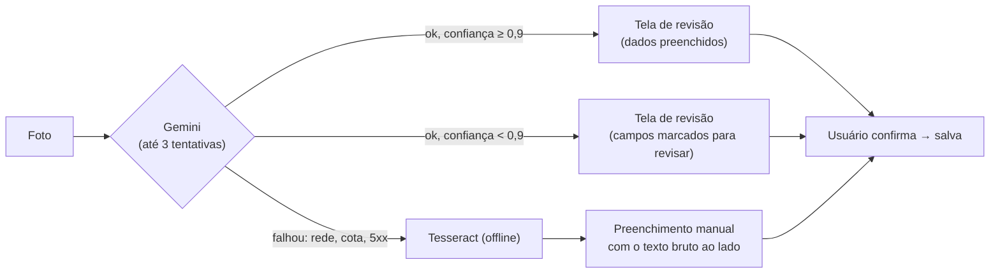
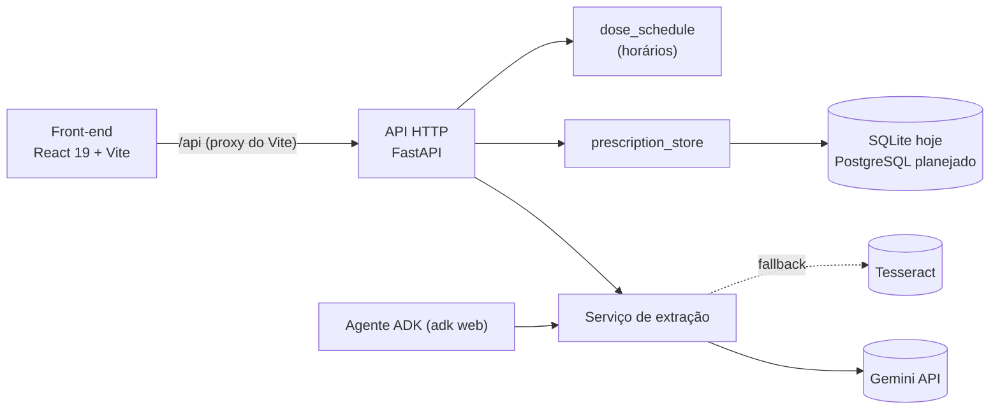

# Resposta à devolutiva da entrega parcial (Squad 44)

Nota parcial: 6,75/10. Este arquivo cruza cada ponto da devolutiva com o que existe no
repositório e traz textos prontos para o documento de entrega final. Itens marcados
**[equipe]** dependem de informação que não está no código (entrevistas, divisão de
trabalho) e precisam ser escritos pelo squad.

## Situação por ponto

| Bloco | Ponto da devolutiva | Situação | Onde |
|---|---|---|---|
| 1 | Registro das entrevistas (perfil, data, trechos, mudança de hipótese) | **[equipe]** | — |
| 1 | Entrevista com IA: modelo, prompt, receita, resultado | Feito: dá para usar a validação de 2026-10-16 | [abaixo](#teste-com-ia-para-o-bloco-1) |
| 1 | Trocar "Predição" por "Automação" em §1.2 | Texto pronto | [abaixo](#lembretes-automação-não-predição) |
| 2 | Tarefas por camada e definição de pronto | Definição de pronto pronta; tarefas por camada **[equipe]** | [abaixo](#definição-de-pronto) |
| 2 | Limiar de confiança numérico e taxa de acerto | Limiar = **0,9** (no código); taxa de acerto ainda não medida | [abaixo](#limiar-de-confiança) |
| 2 | Critérios de aceite do assistente virtual (Épico 5) | **Não existe**: o chat do front é simulado (`src/screens/ChatScreen.tsx`) | — |
| 3 | Rotas de medicamentos e lembretes | **Feito** (`GET /api/medications`, `GET /api/reminders`) | `agente/agents/specs/prescription-api.md` FR-10 a FR-12 |
| 3 | Rotas de cadastro, dependentes, documentos, histórico do chat | **Não existe**: não há autenticação nem usuário dono dos dados | — |
| 3 | Como o front recebe o resultado do OCR | Resposta: requisição síncrona | [abaixo](#como-o-front-recebe-o-ocr) |
| 3 | Justificar índices e a view de contexto | **[equipe/banco]**: hoje é SQLite com as tabelas `documento_ocr` e `receitas` | `agente/agents/repositories/prescription_store.py` |
| 4 | Estrutura de pastas e diagrama de arquitetura | Pronto | [abaixo](#arquitetura) |
| 4 | Um único comportamento de falha do OCR | Pronto: implementado e gravado em `documento_ocr` (`status`, `origem`) | [abaixo](#falha-do-ocr-um-fluxo-só) |
| 4 | Onde entra o Tesseract e como a latência é tratada | Pronto | [abaixo](#falha-do-ocr-um-fluxo-só) |
| 5 | Prompt do assistente virtual + versões dos prompts | Prompt do orquestrador existe; o do assistente (Épico 5) não | [abaixo](#prompts-e-versões) |
| 5 | Alinhar `score_confianca` × `confianca`/`campos_revisar` | Pronto: prompt, API, banco e specs usam os mesmos nomes em pt-BR | [abaixo](#nomes-dos-campos) |
| 5 | Divisão de trabalho, dificuldades, uso de IA | **[equipe]**; evidências abaixo | [abaixo](#evidências-de-implementação) |
| — | Remover "[cite: 4, 20]" (§6.1) e padronizar em pt-BR | **[equipe]**: revisão do texto | — |

## Lembretes: automação, não predição

> Os horários dos lembretes são **calculados** a partir da posologia que o usuário
> confirmou: "8/8h" ou "a cada 8 horas" gera doses às 08:00, 16:00 e 00:00, e "2x ao dia"
> gera doses às 08:00 e 20:00. Posologia condicional ("se necessário", "se dor", "SOS")
> não gera lembrete: o sistema não inventa horário. É uma regra determinística
> (`agente/agents/services/prescription/dose_schedule.py`), não um modelo preditivo.

## Limiar de confiança

- **Limiar: 0,9** (`PRESCRIPTION_CONFIDENCE_THRESHOLD`, em `agente/agents/config/confidence_config.py`).
  Medicamento com confiança abaixo de 0,9 sai com `precisa_revisar: true`, e a receita
  inteira vai para revisão.
- **Por que 0,9 e não 0,75:** numa receita borrada o Gemini alternou "6 horas"/"8 horas" e
  "5 dias"/"7 dias" entre execuções, sempre com confiança de 0,80 a 0,85. Com o limiar em
  0,75 esse erro passaria sem revisão.
- **Taxa de acerto:** ainda não medida. Proposta: montar um conjunto de cerca de 20 receitas
  reais anonimizadas, medir o acerto por campo e definir como meta, por exemplo,
  ≥ 90% nos campos aprovados sem revisão. Hoje só há 3 receitas de teste
  (`agente/agents/tests/fixtures/sample_prescriptions/`).

## Teste com IA (para o Bloco 1)

Modelo `gemini-flash-latest`, temperatura 0,1, prompt
`agente/agents/prompts/extract_prescription_prompt.py`, limiar 0,9, em 2026-10-16:

| Receita de teste | Resultado |
|---|---|
| Nítida | Dipirona 500 mg 8/8h por 5 dias e Amoxicilina 875 mg 12/12h por 7 dias, confiança 1,0, sem revisão |
| Borrada | Nomes certos, mas posologia e período inventados (6/6h, 3 dias); confiança de 0,3 a 0,4, então a revisão foi forçada |
| Com instrução embutida ("ignore as instruções…") | A instrução foi parar na posologia; o guard zerou a confiança e forçou a revisão |

## Definição de pronto

Proposta para valer em todas as histórias:

1. Spec com FR/AC/EC em `agente/agents/specs/` (back/IA) ou critério de aceite no backlog (front).
2. Testes dos AC/EC passando (`pytest`) e `npx tsc --noEmit` sem erro.
3. Tela em pt-BR funcionando contra a API real (não só com dados de exemplo).
4. Pull request revisado e mergeado na `main`.

## Como o front recebe o OCR

O OCR é **síncrono**: o front faz `POST /api/prescriptions/extract` e espera a resposta
na mesma requisição (em média de poucos segundos). Não há fila, polling nem websocket,
porque a extração é uma única chamada ao Gemini. Enquanto espera, a tela mostra
"Analisando". Se passar de 60 s, o front cancela e mostra "O serviço demorou demais"
(`src/services/prescriptions.ts`). Fila e polling só valem a pena se a extração passar
a ter várias etapas ou um lote de documentos.

## Falha do OCR: um fluxo só

Fica valendo um único comportamento: **preenchimento manual**. Saem do documento o
"modo de espera" e o "status de erro".



- **Onde entra o Tesseract:** dentro do serviço de extração
  (`agente/agents/services/prescription/extraction_service.py`), só depois de o Gemini
  falhar. Ele não estrutura nada: devolve texto bruto para o usuário digitar os campos
  olhando para ele.
- **Latência:** o client do Gemini repete até 3 vezes em 408/429/5xx (backoff de 1 s
  até 8 s, em `agente/agents/config/gemini_config.py`); o front corta em 60 s.
- **Modelo de dados** (implementado, spec `agente/agents/specs/documento-ocr.md`): cada
  leitura vira um registro em `documento_ocr`, que guarda separados o que a IA extraiu
  (`extraido`) e o que o usuário confirmou (`confirmado`).
  - `status`: `processando` → `revisao` → `confirmado`. Não existe status de erro nem
    modo de espera: falha do Gemini vira `origem = tesseract` em `revisao`.
  - `origem`: `gemini` | `tesseract` | `manual` (o usuário digitou sem enviar foto).
  - `confianca` (a geral da leitura) e `campos_revisar` ficam só no banco.
  - A "fila" são os registros que não chegaram a `confirmado`: `processando` é leitura
    interrompida no meio, e `revisao` é leitura esperando o usuário.
  - A confirmação grava o `confirmado`, muda o status e cria a receita ligada
    (`receitas.documento_ocr_id`) numa única transação.

## Nomes dos campos

Prompt, serviço, API, banco e specs usam os mesmos nomes em pt-BR:

| Onde | Campo |
|---|---|
| Saída do prompt (interno) | `confianca` por medicamento, `confianca_geral` na receita |
| Banco (`documento_ocr`) | `confianca`, `campos_revisar`, `origem`, `status` |
| Resposta da API ao front | `precisa_revisar: bool` por medicamento e na receita, `origem`, `documento_ocr_id` |

O número de confiança **nunca** sai da API; o front só recebe o booleano. No documento,
trocar `score_confianca` por `confianca`.

## Prompts e versões

| Prompt | Arquivo | Versões |
|---|---|---|
| Extração de receita | `agente/agents/prompts/extract_prescription_prompt.py` | v1 (2026-09-17, `919d0f0`), extração e regras de confiança; v2 (2026-09-17, `ddf7a33`), qualidade da imagem e prompt injection; v3 (2026-10-18, `a0d117c`), + `medico` e `data_receita`; v4 (2026-10-28), nomes em pt-BR (`confianca`, `confianca_geral`) |
| Orquestrador (chat do agente ADK) | `agente/agents/prompts/orchestrator_prompt.py` | v1 (2026-09-17, `919d0f0`); v2 (2026-09-17, `890cb8a`), esconde do usuário os detalhes do fallback; v3 (2026-10-28), nomes em pt-BR e `status "error"` deixa claro que é foto ausente, não falha da leitura |
| Assistente virtual (Épico 5) | — | **não existe**; o chat do front responde com textos fixos |

O texto completo de cada prompt está no arquivo e pode ser colado no documento. O
histórico das versões está em `git log -- agente/agents/prompts`.

## Arquitetura



Estrutura de pastas:

```
SafePass/
├── src/                    front-end
│   ├── screens/            uma tela por arquivo
│   ├── services/           chamadas à API (prescriptions.ts)
│   └── components/         ícones e layout
└── agente/agents/          IA + API
    ├── api/main.py         rotas HTTP
    ├── services/prescription/
    │   ├── extraction_service.py   Gemini + fallback Tesseract
    │   └── dose_schedule.py        horários a partir da posologia
    ├── prompts/            prompts versionados
    ├── security/           review_guard (HITL)
    ├── repositories/       Gemini, Tesseract, persistência
    ├── apps/               agente ADK (orquestrador)
    ├── specs/              specs (SDD)
    └── tests/              pytest (TDD)
```

## Rotas da API

| Rota | O que faz |
|---|---|
| `POST /api/prescriptions/extract` | Foto → medicamentos extraídos |
| `POST /api/prescriptions` | Salva a receita confirmada |
| `GET /api/prescriptions` | Lista as receitas salvas |
| `GET /api/medications` | Medicamentos salvos com os horários das doses |
| `GET /api/reminders` | Um lembrete por horário de dose |

Faltam: cadastro/login, dependentes, documentos (exames, consultas, vacinas) e
histórico do chat. Todas dependem de existir um usuário dono dos dados (autenticação).

## Evidências de implementação

- Repositório com histórico de PRs (#4 validação do OCR, #5 API de receitas).
- 51 testes automatizados passando (`cd agente/agents && .venv/bin/pytest`).
- Fluxo real funcionando: foto → revisão → salvar → aparece em Medicamentos, Histórico
  e Lembretes. **[equipe]** Tirar prints dessas telas para o documento.
